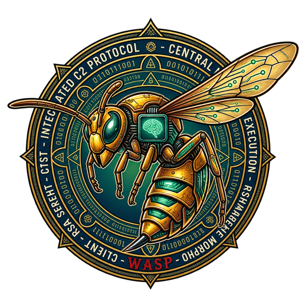
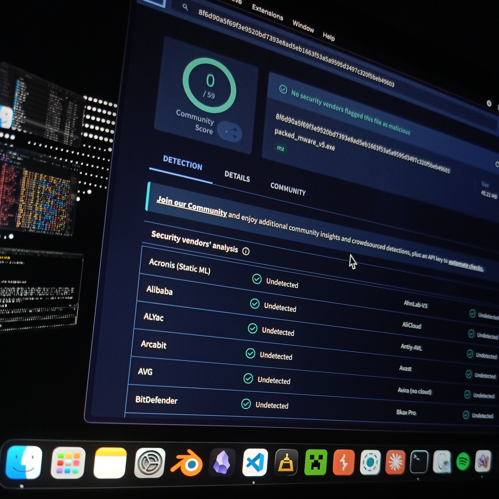
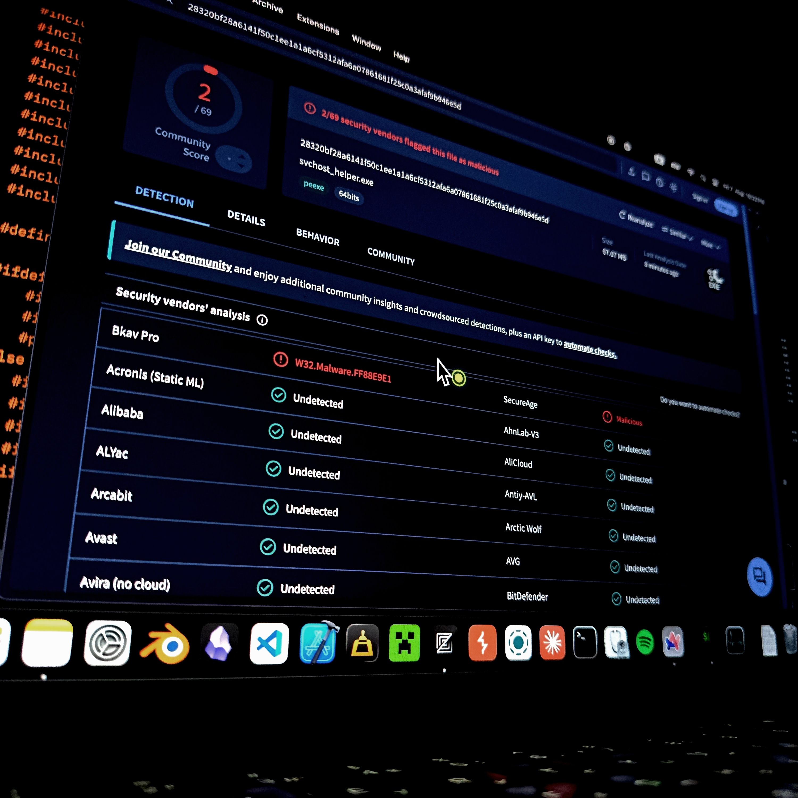

# MWare — Modular Ransomware Simulation & C2 Framework

A single-machine **ransomware simulation** with a real C2 channel, built for red-team
training, EDR/AV detection engineering and malware-analysis courses. Everything runs
in your own lab: the "victim" file is a 3-line text file created next to the binary,
the decryption password is a fixed test constant, and nothing leaves the host.

<p align="center">
  
</p>

> **Authorized use only.** Point this at systems you own or have written permission
> to test. See [Legal](#legal) before you build it.

---

## What it does

The macOS GUI shows a full-screen ransom note ("THE WASP HIVE"). The window refuses
to close — every close event is vetoed and the cursor is pulled back inside — until
the correct key is typed into the `UNLOCK FILES` field. On a successful unlock the
file is decrypted, the window closes, and a headless C2 bot (`UserEventAgent`) is
spawned to connect back to the operator.

Behind the note, every module in the framework is real code:

| Area | Implementation |
|---|---|
| Symmetric crypto | ChaCha20-Poly1305 (RFC 8439), per-file key + 12-byte nonce stored in the file header |
| Key exchange | X25519 ECDH → HKDF-SHA256 → transcript-bound session key |
| Mutual auth | HMAC-SHA256 PSK confirmation in both directions (constant-time compare) |
| Wire protocol | 4-byte BE length + XOR checksum framing; handshake frames XOR-obfuscated, commands AEAD-encrypted |
| C2 server | `RSW` — interactive operator console (bot list, key captures, command dispatch) |
| C2 client | `UserEventAgent` — headless bot, raw TCP :8080, reconnect loop |
| Persistence | Registry Run key (Windows), LaunchAgent (macOS) |
| Evasion | Static API resolution by hash, string obfuscation, sandbox/VM checks, sleep obfuscation, stack spoofing |
| Injection | Threadless injection, thread hijacking (Windows), each technique in its own file |
| Windows packaging | static MinGW build, `resource.res` masquerade, `VT_CLEAN` variant that strips the ransomware path |

The demo password is `WaspHive2024!` — it is compiled into `crypto.cpp` on purpose.
It is not a secret and not meant to be one.

---

## Build

### Requirements

- **macOS GUI + server**: `clang++` with C++17, wxWidgets 3.3 via Homebrew
  (`brew install wxwidgets`), `make`.
- **Windows cross-build**: `x86_64-w64-mingw32-g++` plus a static wxWidgets for
  MinGW at `/usr/local/wx-mingw` (the Makefile errors out early if it is missing).

### Targets

```bash
make                # MWare.exe        — Windows GUI (static, stripped)
make mac-gui        # MWare-gui        — macOS GUI + UserEventAgent child
make RSW            # RSW              — C2 server on :8080
make console        # sys_check.exe    — headless Windows bot, no wxWidgets
make vt             # sys_check.exe    — headless, silent, ransomware path GC'd out
make test           # build + run the full test suite
make clean
```

`make mac-gui` also builds `UserEventAgent`, because `MWare-gui` spawns that exact
binary by name on a successful unlock.

---

## Run

```bash
# 1. operator console
./RSW                        # listens on 0.0.0.0:8080
RSW_PSK="shared-secret" ./RSW   # enable mutual-auth PSK (else ECDH-only mode)

# 2. victim side
./MWare-gui                  # creates target.txt, encrypts it, shows the note
                             # type WaspHive2024! + Enter -> decrypts + spawns the bot
```

The PSK can also live in `psk.txt` next to the binary — that file is git-ignored.

### Test

```bash
make test          # everything: 14 + 29 unit assertions + live handshake
make test-kex      # SHA-256 / HMAC / HKDF / X25519 against RFC vectors
make test-crypto   # ChaCha20-Poly1305, failure modes, file encrypt/decrypt
make test-e2e      # full handshake against a live ./RSW (binds :8080)
```

`make test-e2e` starts its own `RSW` with a throwaway PSK, drives the bot-side
handshake (`BOT_CONNECT → SESSION_PUB → CLIENT_PUB+confirm → AUTH_OK → AEAD
KEY_EXFIL`), then asserts on the **server's own log** that the bot authenticates and
the key capture lands. Port 8080 must be free.

Covered by tests: the whole key-exchange layer and the whole symmetric/file layer
(`encryptTargetFile` / `decryptTargetFile`, including "wrong password fails closed
and leaves the ciphertext intact").

**Not covered yet** — contributions welcome:

- the GUI key-entry path (`ScenePanel` char handling — it has already produced one
  real bug: `CHAR_HOOK` delivers untranslated key codes, so `!` arrived as `1`)
- `RSW` operator-command parsing
- persistence install / verify / remove
- the Windows-only evasion and injection modules (no CI for them)

---

## Layout

```
MWare/
├── main.cpp              entry point, mode selection
├── gui.{h,cpp}           wxWidgets ransom screen (fully self-drawn, no native controls)
├── crypto.{h,cpp}        ChaCha20-Poly1305, key derivation, file encrypt/decrypt
├── keyexchange.{h,cpp}   SHA-256, HMAC, HKDF, X25519, session keys, PSK MACs
├── c2_agent.cpp          bot side: handshake, beacon, command handling
├── c2_client.cpp         headless UserEventAgent entry point
├── persistence.cpp       registry / LaunchAgent persistence
├── evasion.cpp           API hashing, string obfuscation
├── sandbox_evasion.cpp   VM / sandbox detection
├── sleep_obfuscation.cpp encrypted sleep, memory region shuffling
├── stack_spoof.cpp       call-stack spoofing
├── thread_hijack.cpp     thread hijacking
├── ThreadlessInject.cpp  threadless injection
└── lolbas.cpp            living-off-the-land binary abuse

tests/                    unit + e2e suites (wired into `make test`)
RSW.cpp, rsw_protocol.*   C2 server and its stateless protocol layer
```

---

## Security design notes

These are the properties the code is actually built for, and the ones the tests pin:

- **Fail closed.** A wrong password, a flipped ciphertext bit, a modified Poly1305
  tag or a wrong nonce all make `chacha20Poly1305Decrypt` return an empty vector.
  The caller never writes unverified plaintext to disk.
- **Ephemeral keys.** Every file gets a fresh 32-byte key and a fresh 12-byte nonce,
  both stored alongside the ciphertext (the key is printed to the operator console).
- **Mutual authentication.** The bot proves the PSK to the server and the server
  proves it back; both MACs bind the transcript, so a replayed or substituted
  handshake fails.
- **Constant-time comparison** for all MAC checks.

Known limitations, stated up front:

- The 16-byte tag is stored inside the ciphertext blob; there is no separate
  authenticated metadata (nonce is header-only and not covered by the tag).
- `encryptSingleFile()` generates a random key but has no decrypt counterpart —
  only the fixed-password `encryptTargetFile` / `decryptTargetFile` pair round-trips.
- The `VT_CLEAN` build is the only variant that removes the ransomware path; the
  default Windows build keeps it.
- No CI. `make test` is the whole gate, and it only runs on macOS today.

---

## Detection results

Two builds from the v5 packaging pipeline — `build_v5.py` (polymorphic decryptor,
section padding, fake import table) with `loader_stub_v5.cpp` (module stomping) —
were submitted to VirusTotal after release.

| Build | File | Size | VirusTotal | Engines that fired |
|---|---|---|---|---|
| v5 Build #2 | `packed_mware_v5.exe` | 40.21 MB | **0 / 59** | — clean across the board |
| v5, headless `sys_check.exe` payload | `svchost_helper.exe` | 67.07 MB | **2 / 69** | Bkav Pro → `W32.Malware.FF88E9E1`, SecureAge → `Malicious` |

<p align="center">
  
  
</p>

Both are unedited photos of the screen, so the address bar, the "last analysis date"
and the SHA-256 of the exact file that was scanned are all still in frame.

How to read this, because a scan count is easy to over-read:

- **A clean static scan is not invisibility.** 0/59 means the bytes on disk match
  no engine's signature, which is what packing is for. It says nothing about
  runtime behaviour — an EDR watching process injection, a memory scanner, or a
  human analyst in a sandbox will still see the technique. Detection engineering
  is exactly the audience this repo is written for.
- **It is not a property of the current source tree.** These two binaries came out
  of the v5 pipeline, which is still in the repo (`build_v5.py`,
  `polymorphic_decryptor.py`, `loader_stub_v5.cpp`), but `make` builds a different
  artifact today. Rebuild and re-scan before quoting a number about your own build.
- **The two remaining hits are generic heuristics, not family attribution.**
  Bkav Pro reports a hash-suffixed name with no family (`W32.Malware.FF88E9E1`),
  SecureAge reports plain `Malicious`. Neither identifies what the program does.
- **Scores drift.** Engines add signatures continuously, and VirusTotal rotates
  which engines are enabled per scan (59, 62 and 69 here across builds), so today's
  count is not the count you will see tomorrow.

---

## Legal

This repository is a **simulation for authorized security work**: your own lab,
an isolated VM, a CTF, or a sanctioned red-team engagement with written scope.

It encrypts exactly one file (`target.txt`) with a password that is published in the
source, has no propagation, no anti-recovery wipe, and no working payment path.
Running it against systems you do not own or have permission to test is illegal in
most jurisdictions and is not an authorized use of this code.

Provided under the MIT license, with no warranty of any kind. You are responsible
for how you use it.
